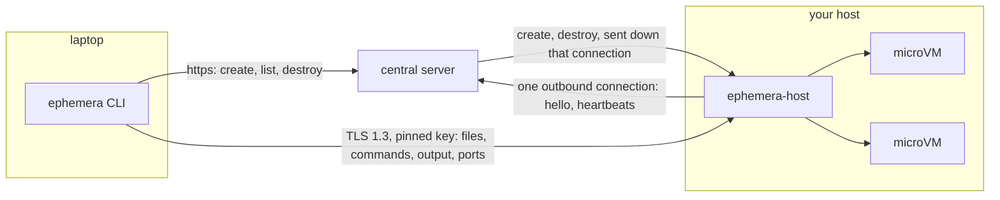

ephemera has three parts. Your **laptop** has the code and the `ephemera` CLI. **Hosts**, Linux machines you own, run the sandboxes. A small **central server** keeps track of which hosts you have and picks one for each sandbox. Files and output go straight between your laptop and the host. The central server gets ids, names and times, never your files.

| Part | Binary | Job |
| - | - | - |
| CLI | `ephemera` | Sends your worktree, runs commands, streams output, saves records |
| Central server | `ephemera-server` | Keeps accounts, tokens and hosts, places sandboxes. Hosted at `api.ephemera.run`, or [run your own](/self-hosting) |
| Host agent | `ephemera-host` | Runs sandboxes as Firecracker microVMs on a Linux machine with KVM |
| Guest agent | `ephemera-guest` | Runs inside each microVM as its first process, and runs your commands |

## One run, step by step

When you type `ephemera run -- npm test`:

1. The CLI makes a random access token for the new sandbox and asks the central server for a sandbox, sending only the token's SHA-256.
2. The central server picks, among your connected hosts with room, the one running the fewest sandboxes, and sends it the create over the host's own connection. It answers the CLI with the host's address and key.
3. The host restores a microVM from a snapshot, in about 65 ms.
4. The CLI connects to the host over TLS 1.3, checks the host's key against the one the central server has for it, and pins it the first time.
5. The CLI sends the files git would track, as one archive. The command runs, and its output streams back as it happens.
6. When the command ends, or you press Ctrl-C, the CLI destroys the sandbox. The host deletes its disk, signs a record of what happened, and the CLI saves the record on your laptop.

`ephemera run` exits with the command's exit code, so it drops into scripts and CI.

## Hosts dial out

A host never waits for the central server to call it. It keeps one connection open to the central server, signs in on it with its own Ed25519 key, and checks in every 15 seconds. The central server sends creates and destroys down that connection. So a host can sit behind NAT, with no port open to the internet for ephemera.

Every check-in lists the sandboxes the host is running. Any the central server has no record of are destroyed, so nothing keeps running unseen. A host the central server has no record of at all, because it was removed, destroys all its sandboxes.

Your laptop is the one thing that does connect to a host: to send files, read output and forward ports. So it needs to reach the host's address, on the same network or over a VPN.

## Inside a host

Each sandbox is a Firecracker microVM with its own kernel:

- **It boots read-only** from the host's guest image (Ubuntu 24.04 with git, Python, Node.js 24 and build tools), with a disk of its own for everything it writes, so `apt install` works. The disk is deleted with the sandbox.
- **It starts from a snapshot** of a booted VM, in about 65 ms instead of about 900 ms, when it has the default size. Other sizes boot. Each one gets its own copy of the snapshot's disk, its clock set and its random number generator reseeded, and shares the snapshot's memory until it writes to it: an idle sandbox costs the host about 60 MB.
- **It runs in a jail.** Firecracker's jailer gives every microVM a chroot holding only its own files, a user ID of its own, and cgroup limits on memory, CPU and processes.
- **It has no network device.** The host talks to the guest agent over vsock. Programs in the sandbox reach the internet only through a proxy that checks each connection against the sandbox's allow list. See [Network access](/guides/network).

Every host has a maximum lifetime for any sandbox, 24 hours by default, so a forgotten one can't run forever.

## The central server mostly keeps lists

It knows your account, your tokens (as hashes), your hosts and their keys, and the sandboxes running now and those that ran, with when, where, how they ended and how they were set up. It never sees a file, a command's output or an environment value. It can't open a sandbox either: it has only the hash of each sandbox's token, and the CLI keeps the token.

[Security and data flow](/security) lists every hop and everything the central server stores.
