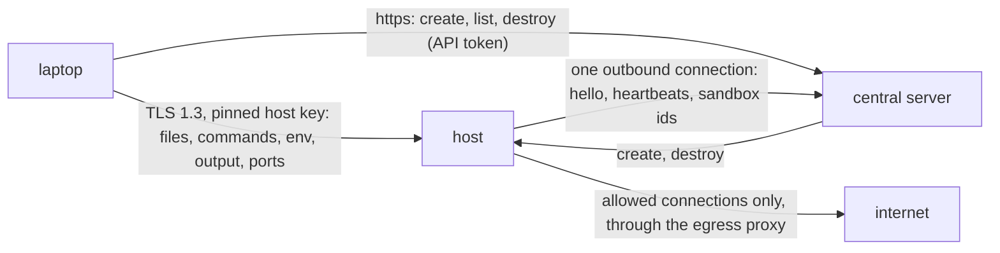

Your files go from your laptop to your host, over TLS 1.3 checked against the host's own key. Output comes back the same way. The central server, hosted at `api.ephemera.run` or run by you, places sandboxes and keeps lists: ids, names, times and keys. It never receives a file, a command's output or an environment value, and it can't open a sandbox.

## Every hop

| What moves | How |
| - | - |
| Your worktree | One archive over TLS 1.3, laptop to host. Only files git would track, plus any you name with `--include` |
| Edits during `ephemera dev` | Each changed file over the same TLS connection |
| Commands and `--env` values | The same connection, laptop to host |
| Output | Streamed back over the same connection |
| Forwarded ports | The same connection to the host, then vsock into the microVM |
| A sandbox's traffic to the internet | A proxy at `127.0.0.1:3128` in the microVM, over vsock to a proxy on the host for that sandbox alone, then out, if the host is allowed |
| Create, list and destroy | HTTPS from the CLI to the central server, with your API token |
| Work for a host | Down the host's own outbound connection to the central server |
| Setup snapshots | Kept on the host, encrypted with a key that goes from your laptop straight to the host |
| Records | Signed on the host, sent back to your laptop, saved there |

## The host connection

The CLI connects to a host over TLS 1.3. The host's certificate is made from the Ed25519 key it joined with, and the CLI checks two things before sending anything:

1. The key in the certificate is the key the central server has on record for that host.
2. It matches the key the CLI pinned the first time it used that host, in `known_hosts.json` next to your login, like ssh's known_hosts.

If a host's key ever changes, the CLI refuses to connect and says so. `ephemera hosts trust <host>` accepts the new key on purpose, for a host you rebuilt. `EPHEMERA_STRICT_HOSTS=1` refuses hosts that aren't pinned yet, for machines that should only ever use hosts you've already checked.

## Who can open a sandbox

Each sandbox has its own access token. The CLI makes it, keeps it, and sends the central server only its SHA-256, which the central server passes to the host. The host accepts requests for that sandbox only with the matching token. So the central server can place and destroy sandboxes, but it can't send files to one, run a command in one, or read its output.

## What the central server stores

| What | Kept |
| - | - |
| Your account | Your GitHub user id, login, name and avatar URL. Sign-in asks GitHub only for `read:user`, never your repositories. GitHub's access token is used once and dropped |
| Sessions | A hash of each session's secret, for 30 days |
| Tokens | Name, kind, limits, when it was made, and a SHA-256 of the secret |
| Hosts | Name, id, public key, when it joined |
| Sandboxes | Id, host, token name, the settings it was made with (image, size, network mode and allow list, lifetime), when it started and ended, and why it ended |
| Usage | Sandbox-seconds per token per day |
| Join codes and sign-in codes | Hashes, until used or expired: 15 minutes for a join code, 10 minutes for a sign-in code |

Never: files, command lines, output, environment values, sandbox tokens, setup snapshots, records, or your GitHub token.

## On the host

A host is a machine you own, so it sees what runs on it: your files, commands and output, inside the microVM. What it keeps:

- **Nothing of a sandbox after it's destroyed.** Its disk is deleted with it.
- **Setup snapshots**, encrypted with AES-256-GCM. The key is made on your laptop, stays in your config folder, and goes to the host only while it saves or restores one. The host decrypts a snapshot only into the folder of the sandbox using it. See [Setup snapshots](/guides/setup).
- **Its own key**, `/var/lib/ephemera/host.key`. It signs the host in and signs its records. Keep it root-only.

Each microVM runs under Firecracker's jailer: its own chroot, user ID and cgroup limits. It has no network device; see [Network access](/guides/network) for how outbound traffic is checked.

## Records

When a sandbox is destroyed, its host signs a record: every command line with its exit code and duration, every file sync's count and size, every network connection allowed or blocked, and that the disk was deleted. It holds no output, file contents or environment values. The record goes to your laptop only. `ephemera verify` checks the signature and that the key is the one the central server has for that host. See [Signed records](/guides/records).

## Every secret

| Secret | Where it lives | What the central server has |
| - | - | - |
| Your API or device token | Your config folder, readable only by you | A SHA-256 |
| Each sandbox's token | The CLI's memory, while the sandbox lives | A SHA-256, passed to the host |
| Your dashboard session | An `HttpOnly`, `Secure` cookie in your browser | A hash |
| A host's key | `/var/lib/ephemera/host.key` on the host | The public half |
| Setup snapshot keys | Your config folder, one per project | Nothing |
| A join code | Wherever you paste it, for 15 minutes | A hash |

<Warning>
  A join code lets a machine become a host in your account, and receive your sandboxes and the code in them. It works once, for 15 minutes. Hand it over the way you would a password.
</Warning>

## Reporting a problem

{/* TODO: private vulnerability reporting is off in the GitHub repo settings; turn it on before this page goes live. */}

Found a security issue? Please report it privately through [GitHub security advisories](https://github.com/pyjeebz/ephemera/security/advisories/new) rather than in a public issue.
